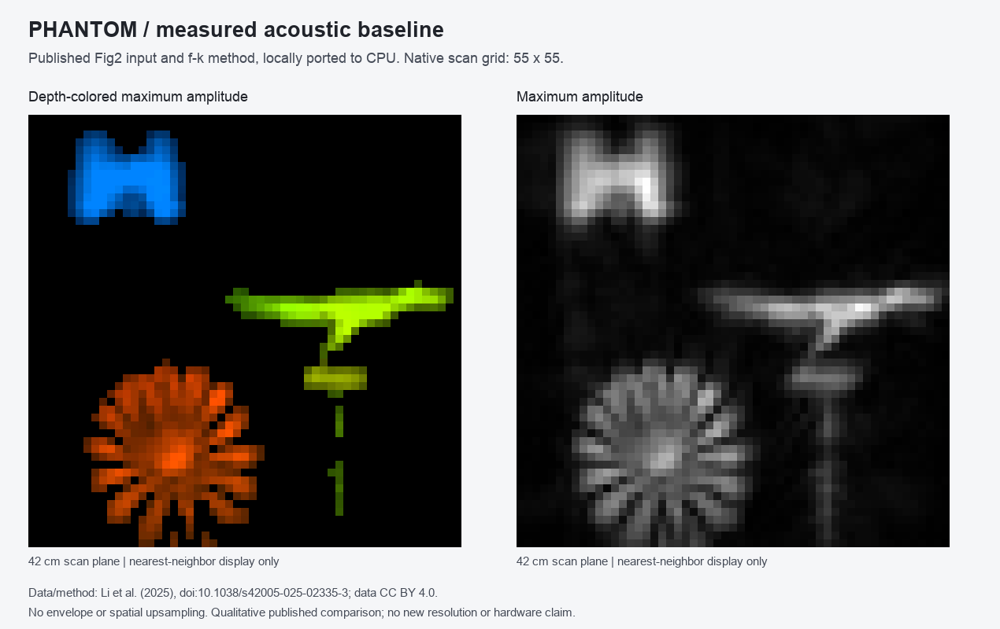

# EchoSight

[](pyproject.toml)
[](requirements.txt)
[](docs/MEASURED_NLOS.md)
[](docs/MEASURED_NLOS.md#exact-input-and-execution)
[](https://github.com/nazeeh111/EchoSight/actions/workflows/ci.yml)

Reconstruct a scene from published ultrasound measurements, inspect native depth slices, and retain the arrays and source provenance. PHANTOM is this measured non-line-of-sight imaging direction inside EchoSight. The room-recording backend and simulated room demo remain separate routes.



*Actual external measured data, ported from the released method. H, dinosaur and resolution star from Li et al. (2025), CC BY 4.0. [Reproduce this case](docs/MEASURED_NLOS.md).*

| Route | What you can do |
| --- | --- |
| [Measured NLOS / PHANTOM](docs/MEASURED_NLOS.md) | Reconstruct the exact official Figure 2 MAT file; save volume, depth, amplitude and source hashes; inspect native axial slices. |
| [Room-recording backend](docs/USAGE.md) | Import lossless recordings, inspect calibration and supported surface patches, compare reference-based materials, and export/replay results. |
| [Room demo](https://github.com/nazeeh111/EchoSight/tree/backend/implementation/demo) | Explore a supplied room model and simulated scan. It does not connect phones or process acoustic measurements. |

## Install the backend

Use macOS or Linux and Python 3.12 with compatible NumPy/SciPy wheels. Native Windows is unsupported because the local store uses POSIX file locking. The default branch is `backend/implementation`.

```sh
git clone --branch backend/implementation https://github.com/nazeeh111/EchoSight.git
cd EchoSight
python3.12 -m venv .venv
source .venv/bin/activate
python -m pip install .
```

The source distribution includes backend code, text guides, schemas and evaluation scripts. The [full repository](https://github.com/nazeeh111/EchoSight/tree/backend/implementation) retains the room demo, Blender assets, complete tests and frozen evidence. Wheels include the backend and the [upstream attribution/source notice](echosight/notices/li2025/NOTICE.md).

## Reconstruct measured ultrasound

Obtain the [exact official input](docs/MEASURED_NLOS.md#exact-input-and-execution) yourself. This fixed **55 × 55 × 25,000** case estimates **6 GiB** working memory. No data are downloaded automatically. Add `--estimate-only` to verify the input and inspect resource estimates without decoding or creating output.

```sh
mkdir -p work
echosight nlos-fig2 --input /your/data/2024_2_29_22_26_32641_star_dig_H.mat \
  --output work/fig2 --preset li2025-fig2-phase-native \
  --sample-rate-hz 1000000
```

Use a new output directory. Open its self-contained `inspection.html` to scrub native depth bins and inspect a pixel’s amplitude profile, source-array location and threshold sensitivity. Crossings use full-precision arrays; the displayed curve is quantized. `report.json` records provenance, resource use and artifact hashes; NumPy arrays retain full precision. [Method, evidence and limits](docs/MEASURED_NLOS.md#method-evidence-and-limits) distinguish this released-code baseline from calibrated room geometry and future adaptive work.

## Other local routes

Generate and process twelve **synthetic** room recordings, or start the separate recording API:

```sh
python -m echosight demo work/room --seed 1 --captures 12
python -m echosight inspect work/room/result.json
python -m echosight serve --root work/store --port 8766
```

The room-recording workflow uses one fixed sound source and surveyed microphone positions. Its JSON geometry and evidence do not drive the animated room demo. [Recording inputs, calibration and replay](docs/USAGE.md).

From a full Git checkout, open the simulated room demo with Python's standard library:

```sh
python3 demo/server.py --open
```

Its confidence labels, echo directions and material/color estimates are simulated. [Demo controls and optional local Qwen/Ollama assistant](https://github.com/nazeeh111/EchoSight/blob/backend/implementation/demo/README.md), [model provenance](https://github.com/nazeeh111/EchoSight/blob/backend/implementation/demo/MODEL.md). The assistant performs no acoustic measurements; the demo works without it. An additional [Blender room animation](https://github.com/nazeeh111/EchoSight/blob/backend/implementation/examples/rooms/room_2_final_animated.blend) remains available in the repository.

## Checks

From a full Git checkout, with the virtual environment active:

```sh
python -m pip install -r requirements-test.txt
python -m unittest discover -s tests -v
python -m unittest discover -s demo -p 'test_*.py' -v
python -m evaluation.run --output work/held-out
python -m evaluation.run --extended --output work/held-out-extended
```

HTTP tests need temporary loopback ports. Scientific evaluations exit nonzero when their frozen criteria fail; passing software tests does not establish physical accuracy. [Evaluation guide](docs/EVALUATION.md).

## Scientific status

Controlled synthetic demonstrations recover room surfaces. Harder synthetic cases and external measured-room replays retain failures. Physical validation with our phones and laptop remains pending, and full scientific acceptance has not been met. The [frozen room state and evidence](https://github.com/nazeeh111/EchoSight/blob/backend/implementation/STATE.md) preserve those results. The measured Figure 2 route does not promote the room pipeline's acceptance status.

Surface patches describe observed acoustic support, not complete wall edges or safe free space. Backend material comparisons require supplied reference profiles and can return unknown. Sound does not measure optical color; backend colors use supplied contextual palettes. The demo's visual estimates are separate from these research outputs.

## Documentation

- [Documentation index](docs/README.md)
- [API routes and errors](docs/API.md), [frontend contract](docs/FRONTEND_HANDOFF.md), [schemas](schemas/) and [backend result examples](examples/frontend/)
- [Materials and appearance](docs/MATERIALS_APPEARANCE.md), [hardware acceptance](docs/HARDWARE_ACCEPTANCE.md) and [source/license provenance](docs/SOURCES.md)

Keep generated recordings and local experiments in ignored `work/`. The full repository retains frozen scientific results and failure evidence in `evidence/`.

## Reuse permissions

The 19 original Python backend files [listed in the scope](echosight/LICENSE_SCOPE.json) use the [MIT License](echosight/LICENSE). The [scope notice](echosight/LICENSE_SCOPE.txt) preserves the PHANTOM adaptation's CC BY 4.0 terms and upstream notices. Room assets and other unlisted material are outside this MIT grant.
