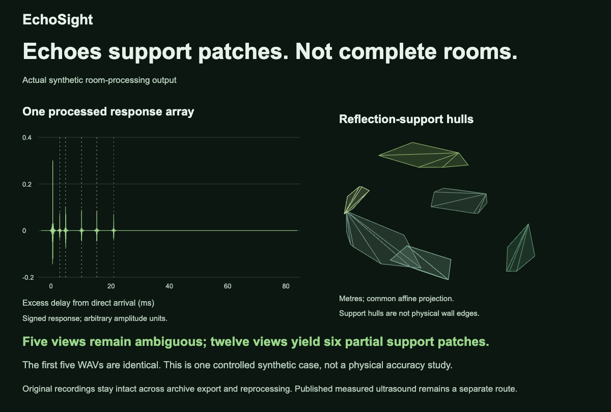

# Preserve recordings. Recompute the interpretation.

This actual local EchoSight workspace journey uses deterministic **synthetic room recordings**. It is separate from PHANTOM's published measured-ultrasound case. Five surveyed synthetic views remain ambiguous; twelve retain six partial support patches. Every original WAV survives processing, calibration editing, archive export and independent replay.

<picture>
 <source media="(max-width: 600px)" srcset="echo-support-mobile.png">
 
</picture>

[Actual desktop workspace](workspace.png) · [Phone workspace](workspace-mobile.png) · [Original recording archive](raw-session.zip) · [Exact twelve-view result](twelve-view-result.json) · [Freshly replayed result](replayed-result.json)

## From echoes to supported patches

The current public default branch is `backend/implementation`, parent `8759b0faa462b47d35bfc7d46755bc32e21cca1a`, version 0.3.4.dev0. This run uses Python 3.12.13 with the exact declared NumPy 2.3.5 and SciPy 1.18.1. No hardware, microphone, phone, provider, training or private recording was used.

The actual CLI ran two seed 1 synthetic fixtures: five captures and twelve captures. Their first five original WAV files are byte-identical. The five-view result is `ambiguous`, with zero accepted support patches and two retained hypotheses; the twelve-view result is `partial`, with six support hulls and one retained hypothesis. Both retain `refinement_budget_reached`. This is one controlled illustration of view support, not a performance study or measured-room accuracy result.

The left plot preserves all 4,225 samples of capture-00's processed response array at its nominal 48 kHz processing grid. Its delay axis comes directly from `start_delay_s` and `sample_rate_hz`, relative to the direct arrival. Signed amplitudes are arbitrary processing units, not sound pressure. Dashed lines mark the five retained candidate excess delays; they do not establish independent surfaces or absolute confidence.

The right projection uses every actual support-hull triangle in the twelve-view result, with one common affine projection and a uniform screen scale. World coordinates are metres, right-handed, z up. These hulls bound observed reflection support, **not** room edges, complete walls, empty space or safe navigation. Display colors identify patches; they are not materials or optical color. [Figure generator](figure.py), [editable SVG](echo-support.svg), [phone SVG](echo-support-mobile.svg), [input/output hashes](figure-manifest.json).

## The actual expert workflow

In the loopback browser workspace, the session definition became a reviewed upload plan. Keyboard Enter created the session. Twelve original mono WAVs were imported, processed and opened as the exact completed job result. The application exposed geometry, echo support, diagnostics and guidance without promoting the synthetic result to physical validation. Desktop 1440×1050 and phone 390×844 viewport captures are retained; there was no page overflow or JavaScript error.

Changing the supplied sound speed from 343 to 344 m/s advanced revision 12 to 13 and left all recording metadata/hashes unchanged. A stale patch still targeting revision 12 was refused while preserving its edited text. This was a calibration metadata change, not new measured evidence; the prior geometry needs recomputation. A malformed result file left the displayed scene intact. [Exact UI record](browser.json), [before metadata](session-metadata.json), [after calibration](session-after-calibration.json).

## Export is evidence; import requires recomputation

**Export raw archive** downloaded [raw-session.zip](raw-session.zip). All twelve WAV members match the original synthetic inputs byte for byte and match their stored hashes. The archive contains current metadata and the original completed calculation from before the calibration patch. It does not include the later calibration revision or a complete local history. [Archive check](archive-check.json).

In a fresh isolated store, archive import retained the old calculation as quarantined evidence. `get_result` refused to present it as a current result until local processing ran. A separate actual CLI replay recomputed six partial support hulls; their arrays were exactly equal to the accepted twelve-view geometry. This establishes byte preservation and reproducible synthetic processing here, not authenticity of archived claims or physical correctness. Runtime/timestamps/replay metadata are not expected to have identical hashes.

After the [current source installation](../../README.md#install-the-backend), choose new paths:

```sh
echosight replay docs/presentation/raw-session.zip --store work/review-store --output work/replayed.json
echosight inspect work/replayed.json
```

The archive is the native reopenable artifact. [Complete worked-example ZIP](worked-example.zip) also includes original named WAV inputs, probe, session definition, results, figure source and unchanged scope notices. Its own manifest names every included file. It was extracted and checked; replay uses a new store and output. Original session input paths resolve inside that bundle. Keep your own recordings private; this archive contains only generated public fixture data.

## Measured ultrasound remains a separate route

The original README's leading PHANTOM image and hosted inspection are retained with Li et al. (2025) attribution and CC BY 4.0 terms. Their fixed 55×55×25,000 official MAT input estimates 6 GiB working memory. This bounded pass did **not** download or recompute it. No synthetic room output is presented as that measured experiment, and neither route establishes calibrated physical room mapping with our devices. [Measured method and exact official input](../MEASURED_NLOS.md), [scientific status](../../README.md#scientific-status).

## Source and reuse boundaries

EchoSight remains the product name; PHANTOM names its measured imaging direction. The default branch's recording cache, UI and backend remain unchanged; the held older workspace-release branch is not merged. Original MIT applies only to the 19 original backend files in the existing [license scope](../../echosight/LICENSE_SCOPE.json), with adaptation/upstream exceptions preserved. Room assets and unlisted material are outside that grant. This presentation does not broaden the repository's license. No upstream scene, method or application is disguised as original work. [Source notices](../../echosight/LICENSE_SCOPE.txt), [complete workspace contract](../WORKSPACE.md), [recording/analysis limits](../USAGE.md).
